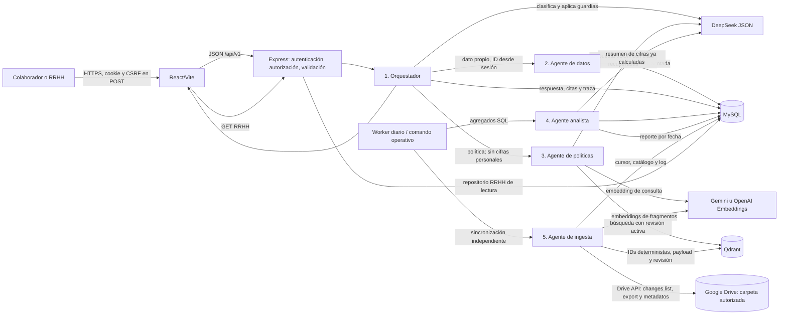

# Arquitectura de Bosque Claro

**Estado del diseño:** implementación académica en evolución, datos simulados. Empresa ficticia: Bosque Claro Servicios Digitales S.A., Costa Rica, 60 colaboradores. La sección de estado al final distingue código preparado de servicios comprobados.

## Vista general: cinco agentes

El camino conversacional coordina tres agentes; el camino de operación ejecuta los otros dos de forma separada. El programador no es un sexto agente: dispara tareas y evita duplicados. Ningún agente cambia las fuentes de verdad: MySQL conserva cifras, Drive conserva documentos y Qdrant solo almacena sus fragmentos vectorizados.

### Responsabilidades y límites

| Agente | Entrada | Fuente y herramienta | Salida | Límite de seguridad |
|---|---|---|---|---|
| Orquestador | Mensaje y contexto autenticado | Reglas deterministas, clasificador DeepSeek, memoria acotada | Ruta, respuesta compuesta, estado y procedencia | No deja al modelo elegir identidad, rol ni permisos. |
| Políticas | Pregunta depurada de cifras personales | Búsqueda Qdrant, embeddings de consulta y DeepSeek | Respuesta sustentada y citas de IDs recuperados | Sin consultas a MySQL; abstiene con score bajo, cita inválida o cifra sin evidencia. |
| Datos | Tipo de pregunta y `colaborador_id` de sesión | Repositorios SQL de lectura | Cifra propia exacta, reporte autorizado o ausencia explícita | No recibe SQL del modelo ni ID desde el cuerpo/query. |
| Analista | Fecha de negocio | Agregaciones MySQL y DeepSeek para resumen | Ocho componentes JSON y resumen validado | El modelo recibe agregados, no elige ni calcula cifras; no publica si falla validación. |
| Ingesta | Carpeta y cursor configurados | Google Drive API, extractores y proveedor de embeddings | Fragmentos con metadatos y revisión activa en Qdrant | Solo carpeta permitida; valida hijos directos y rechaza shortcuts. |

## Flujo conversacional

1. React llama Express con cookie de sesión; las mutaciones incluyen `Origin` permitido y `X-CSRF-Token`. La validación rechaza campos adicionales y mensajes fuera de límites.
2. Express vuelve a leer el usuario/colaborador activos y su rol desde MySQL. El limitador de chat se aplica por usuario autenticado.
3. Antes de cualquier acceso personal, el orquestador aplica guardias de terceros sobre el mensaje original y el mensaje de seguimiento resuelto. Las peticiones restringidas reciben un error genérico.
4. DeepSeek clasifica en JSON. Esa etiqueta no habilita acceso: el código solo consulta datos personales si reconoce un selector propio permitido y siempre usa el ID autenticado.
5. La ruta de datos devuelve una cifra de MySQL. La ruta de políticas vectoriza la consulta, filtra Qdrant por carpeta, estado documental, espacio semántico y revisión SQL activa, y pasa fragmentos como datos no confiables a DeepSeek.
6. El validador conserva únicamente citas cuyos fragment IDs pertenecen a la recuperación actual, comprueba enlace e ID de Drive y evita que la respuesta agregue cifras ausentes de los fragmentos.
7. Las consultas, las ejecuciones de cada agente, su latencia, el estado y los fragmentos quedan registrados. Una consulta mixta conserva por separado el dato SQL y la cita documental; si la parte de política falla, devuelve esa limitación sin inventar evidencia.

### Memoria por usuario

Cada consulta de ejecución persiste en `consultas_chat`; `respuesta_json` se añadió mediante migración 15 para reconstruir el historial. `GET /chat/historial` filtra por el colaborador de la sesión y excluye filas `origen=fixture`; tiene `limit`/`offset` acotados. El contexto conversacional se limita a cinco consultas previas del mismo usuario. Las respuestas personales o mixtas no se entregan al agente de políticas. Los fixtures de analítica no participan en memoria.

## Fuentes, persistencia y contratos

### MySQL: identidad y cifras

MySQL 8 con InnoDB y `utf8mb4` contiene 14 entidades del esquema original: colaboradores, usuarios, sesiones, vacaciones, solicitudes, incapacidades, movimientos, pagos, evaluaciones, consultas, logs, reportes y estado/documentos de Drive. La migración 15 añade `consultas_chat.respuesta_json`; `schema-v1` permanece como fotografía inmutable y `current-schema` describe la ampliación.

Los saldos y períodos personales solo se consultan mediante repositorios parametrizados. Los montos/DECIMAL se conservan como cadenas al serializar. Fechas de negocio usan `America/Costa_Rica`; instantes se guardan/transportan en UTC. El banco de datos contiene 60 colaboradores de prueba; no se cargan personas reales.

### Google Drive y Qdrant: corpus trazable

La carpeta se identifica con `GOOGLE_DRIVE_FOLDER_ID`. El lector usa `drive.readonly`. Se permite indexar archivos hijos directos; no se siguen shortcuts ni ancestros. Antes y después de extraer contenido se vuelve a comprobar metadato y pertenencia. Google Docs se exporta como texto, Sheets como XLSX y se recorre cada hoja; PDF extrae texto real y falla si no hay texto, sin simular OCR.

El índice usa IDs deterministas por archivo, revisión, chunk y configuración de embedding/chunker. El payload incluye ID/nombre/enlace/version de Drive, sección, `fragmento_id`, revisión, estado simulado, texto, carpeta y fingerprint de proveedor/modelo/dimensión. Solo `preparado_simulacion` entra al corpus académico; no equivale a aprobación jurídica o adopción empresarial.

La carga inicial captura token antes del snapshot, luego aplica cambios. La sincronización incremental pagina `changes.list`, guarda el cursor luego de procesar la página y, ante HTTP 410, reconcilia un snapshot completo. Un `GET_LOCK` de MySQL evita ejecuciones concurrentes; catálogo SQL y Qdrant permiten reintentar operaciones parciales. El folder se limita a un catálogo de esta integración, pues el esquema de Drive no almacena una columna de carpeta por documento.

### LLM y embeddings

El LLM conversacional usa DeepSeek por REST compatible con Chat Completions, configurado con `DEEPSEEK_API_KEY`, `DEEPSEEK_BASE_URL` y `DEEPSEEK_MODEL`; la clave no se comparte con embeddings. JSON mode se usa para clasificación y respuesta de políticas. El sistema comprueba errores, salida vacía/truncada y JSON inválido; la API responde `503` si falta servicio requerido.

Embeddings usan configuración independiente `INGEST_EMBEDDING_*` o el fallback compatible `AI_*`. El preflight real comprobó Gemini y la dimensión configurada. Qdrant usa una colección fija con similitud Cosine, índices de filtros y revisión activa. No se introducen datos personales en embeddings ni Qdrant.

## Seguridad y separación de confianza

- **Sesión:** cookie opaca `HttpOnly`, `SameSite=Lax`, `Secure` en producción; MySQL guarda hash SHA-256, vencimiento/revocación y hash CSRF. No se retorna token de sesión.
- **CSRF/origen:** login exige `Origin` y JSON. Mutaciones autenticadas requieren origen permitido y token CSRF derivado/HMAC; se compara en tiempo constante. Las rutas GET rechazan parámetros de identidad.
- **Autorización:** el rol vigente viene de `colaboradores.rol` bajo la sesión. RRHH puede leer reportes agregados; no obtiene acceso al chat o datos personales de terceros.
- **Privacidad SQL:** los repositorios reciben exclusivamente IDs de `req.auth`; no existe herramienta de SQL generada por LLM. Las solicitudes personales no devuelven `aprobador_id` ni nombres de terceros.
- **Inyección:** mensajes y fragmentos se tratan como entradas no confiables; el prompt manda ignorar instrucciones documentales. El LLM solo produce clasificaciones/respuestas estructuradas. No puede llamar herramientas ni escoger usuario/rol.
- **Trazabilidad:** se registran consulta, agente, estado, tiempo, escalamiento y referencias utilizadas. No se guardan claves, tokens de sesión ni datos de credenciales en logs.
- **Límites:** login aplica rate limit por IP; chat por usuario. Los limitadores son por proceso y requieren almacenamiento compartido en despliegue con varias réplicas.

## Operación y estado comprobado al 18 de noviembre de 2026

| Componente | Preparado / implementado | Comprobado realmente | Pendiente |
|---|---|---|---|
| MySQL y auth | Backend, migraciones 1–15, fixture y sesión | MySQL disponible; login, sesión, vacaciones y migración 15 ya se verificaron en la etapa anterior | 13 pruebas de integración MySQL/HTTP y ocho de navegador aprobadas. |
| Corpus | 12 políticas editables, HTML/CSV/PDF y publicador | Fuentes locales inspeccionadas | Credencial escritora y publicación en Drive. |
| Drive | Lector y sync inicial/incremental | Carpeta autorizada visible; un snapshot real retornó **0 archivos** | Importar documentos y repetir sync; el snapshot vacío no acredita el corpus. |
| Embeddings | Adaptadores Gemini/OpenAI | Gemini generó vector real con dimensión configurada | Indexar fuentes publicadas. |
| Qdrant | REST, colección y búsqueda | Qdrant respondió; colección configurada y sync inicial produjo **0 puntos** | Búsqueda semántica sobre documentos reales. |
| Chat/LLM | Chat, memoria, RAG y DeepSeek client | Pruebas con dobles y validaciones locales | Falta `DEEPSEEK_API_KEY`; no se prueba respuesta real del LLM ni end-to-end RAG. |
| Reporte | Agregaciones SQL, agente, endpoints y worker aislado | Agregados SQL conciliados con fixture; worker arrancó y cerró con SIGTERM | Falta DeepSeek para publicar reporte nuevo e instalar supervisor para continuidad. |
| Evaluación | Banco de 45 y runner HTTP | 45 ejecutadas: 15 aprobadas automáticamente, cero fallidas, 30 bloqueadas; privacidad 21/22 rechazada sin datos | Fidelidad y p90 RAG pendientes; no se declara 80% ni <8 s. HTTP p90 57 ms incluye errores. |

El módulo `createDailyWorker` define reportes a las 07:00 y sincronización independiente, con reintento y locks, pero debe iniciarse explícitamente por un proceso; `server.js` no lo arranca automáticamente en el estado observado. El comando `report:generate` es manual. No se ha grabado video ni se simula publicación o respuestas reales.

## Referencias del proyecto

- [Contrato API](contrato-api.md), [DBML](diagrama.dbml) y [plan de implementación](plan-implementacion.md).
- [Guía de políticas e ingesta](ingesta-drive-qdrant.md), [investigación legal editable](investigacion-politicas.md) y [prompt para credenciales Gemini](PROMPT_GEMINI_ACCESOS.md).
- [Enunciado del mini proyecto](../enunciado.md) y [AGENTS del repositorio](../AGENTS.md).
- Documentación oficial DeepSeek: [Chat Completions](https://api-docs.deepseek.com/api/create-chat-completion/) y [JSON Output](https://api-docs.deepseek.com/guides/json_mode/).
- API Google Drive: [changes.list](https://developers.google.com/drive/api/reference/rest/v3/changes/list), [files.export](https://developers.google.com/drive/api/reference/rest/v3/files/export).
